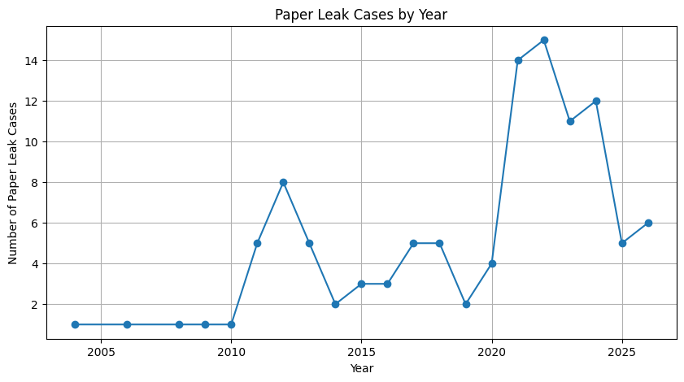
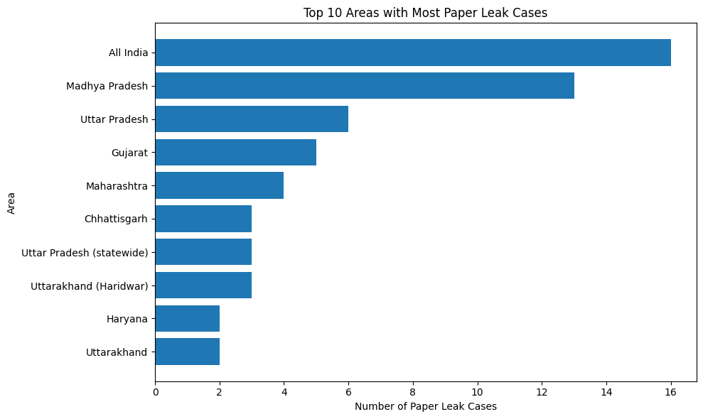
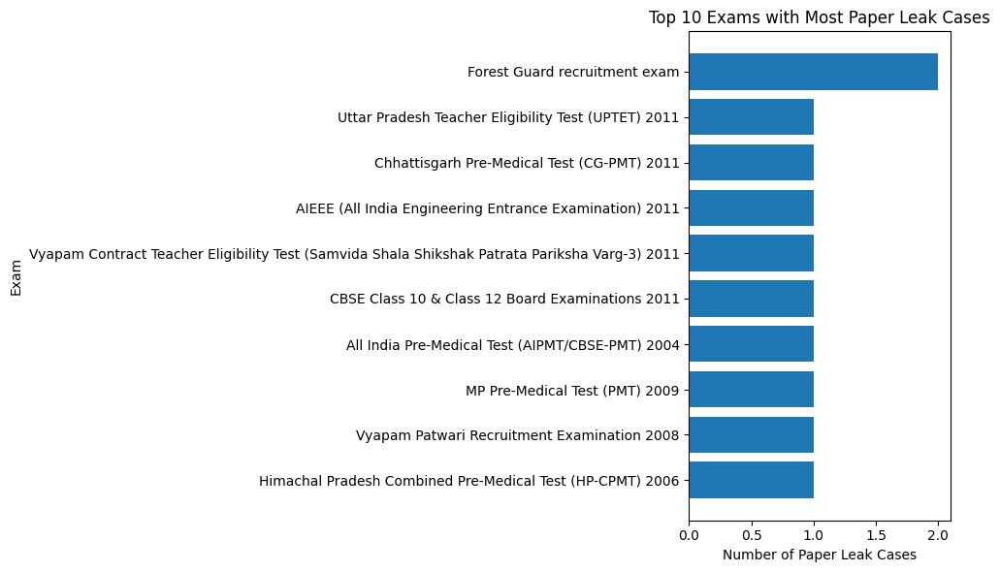
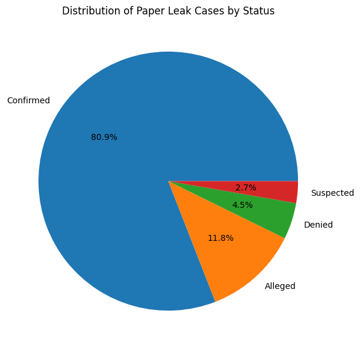
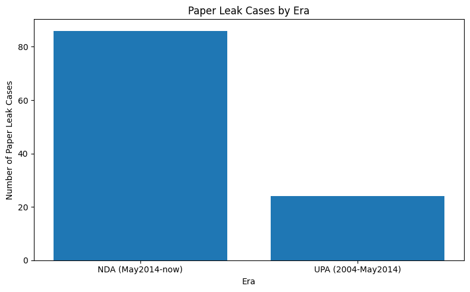
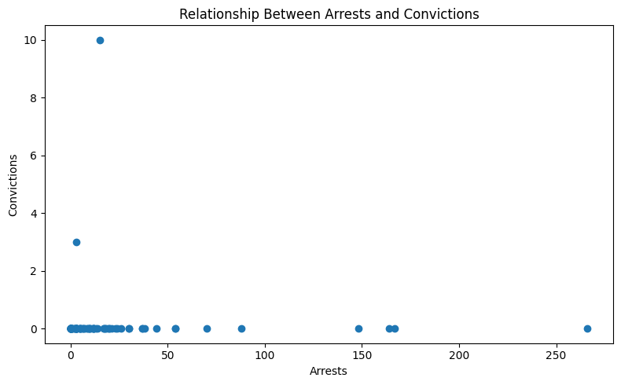

# Indian Paper Leaks Data Analysis (2004-2026)

A data analysis project that studies **110 recorded examination paper leak incidents in India between 2004 and 2026** using Python and Pandas. It follows a step-by-step workflow: data loading, extraction, validation, cleaning, aggregation, analysis, visualization and interpretation.

| | |
|---|---|
| **Course** | Data Analysis Essentials (DAE), Cornerstone Project |
| **Department** | Computer Science and Engineering |
| **Author** | Nammi Vedha Sri (25B11CS659) |
| **Dataset** | India Paper Leaks, 2004-2026 (Kaggle) |

---

## Table of Contents

- [Problem Statement](#problem-statement)
- [Objectives](#objectives)
- [Scope and Significance](#scope-and-significance)
- [Dataset](#dataset)
- [Project Workflow](#project-workflow)
- [Repository Structure](#repository-structure)
- [Methodology](#methodology)
- [Key Findings](#key-findings)
- [Visualizations](#visualizations)
- [Limitations](#limitations)
- [How to Run](#how-to-run)
- [Tools and Technologies](#tools-and-technologies)
- [Author](#author)
- [Conclusion](#conclusion)

---

## Problem Statement

Exam paper leaks in India affect millions of students and disrupt exams and results. The data on these incidents is spread across many records, with missing values and unclear details, so it is hard to see the bigger picture.

This project uses Python and Pandas to clean and analyse 110 paper leak incidents from 2004 to 2026. It finds trends by year, area and exam, compares the UPA and NDA eras, and looks at the number of students affected, arrests and convictions.

## Objectives

- Study recorded paper leak trends in India from 2004 to 2026.
- Identify patterns across years, areas, exams and conducting bodies.
- Examine leak status categories: Confirmed, Alleged, Suspected and Denied.
- Analyse reported aspirant impact where the information is available.
- Examine arrests, convictions, actions taken and linked deaths separately.
- Clean and standardize the dataset before aggregation and visualization.
- Present findings using tables, summaries and charts.

## Scope and Significance

**Scope.** The project covers only the incidents in the supplied dataset (2004 to 2026). It focuses on incident details, exam information, geographic area, conducting bodies, reported impact, legal response, actions taken, sources and confidence.

**Significance.** The analysis gives a structured way to compare incidents across years, exams, areas and conducting bodies. The results are for data analysis and educational purposes. They are **not a complete count** of every paper leak in India.

## Dataset

**Source:** *India Paper Leaks from 2004 to 2026* dataset from Kaggle.
Reference page: https://www.kaggle.com/code/devraai/indian-paper-leaks-analysis-and-prediction

| Item | Details |
|---|---|
| Records | 110 incidents (IDs in the format `PL-0001`) |
| Columns | 18 |
| Date range | April 2004 to July 2026 |
| Leak status | 89 Confirmed, 13 Alleged, 5 Denied, 3 Suspected |
| Raw file | `data/paper_leaks.csv` |
| Cleaned file | `data/paper_leaks_cleaned.csv` |

**Columns**

| Column | Meaning |
|---|---|
| `incident_id` | Unique incident identifier |
| `date` | Incident date |
| `era` | Time period: **UPA (2004-May2014)** or **NDA (May2014-now)** |
| `exam_name` | Examination involved |
| `conducting_body` | Organization that conducted the exam |
| `body_type` | **Central** or **State** conducting body |
| `area` | Recorded geographic area (a state, city, several locations, or `All India`) |
| `leak_status` | Confirmed, Alleged, Suspected or Denied |
| `action_taken` | Recorded response or action |
| `note` | Short description of the incident |
| `arrests`, `convictions` | Reported arrests and convictions, where available |
| `aspirants_affected` | Reported number of candidates affected, where available |
| `linked_deaths`, `deaths_note` | Linked deaths and an explanatory note, where available |
| `source_name`, `source_url` | Source of the information |
| `confidence` | Confidence in the record: High, Medium or Low |

### Data availability

The source data does not report every impact variable for every incident:

| Field | Incidents with a reported value |
|---|---|
| Arrests | 63 of 110 |
| Aspirants affected | 44 of 110 |
| Convictions | 10 of 110 |
| Linked deaths | 4 of 110 |

**Missing values are kept as missing and are not automatically treated as zero**, because a blank means the source did not report a number, not that the number was zero.

## Project Workflow

```
Stage 1            Stage 2                      Stage 3                      Stage 4
Loading &    ->    Extraction, Validation  ->   Aggregation, Representation  -> Visualization, Results
Reading            & Cleaning                   & Analysis                      & Interpretation
```

## Repository Structure

```
Indian-Paper-Leaks-Data-Analysis/
├── 01_Data_Loading_and_Reading/
│   └── Data_Loading_and_Reading.ipynb
├── 02_Data_Extraction_Validation_and_Cleaning/
│   └── Data_Extraction_Validation_Cleaning.ipynb
├── 03_Data_Aggregation_Representation_and_Analysis/
│   └── Data_Aggregation_Representation_Analysis.ipynb
├── 04_Data_Visualization_Results_and_Interpretation/
│   └── Data_Visualization_Results_Interpretation.ipynb
├── Presentation/
│   └── Indian_Paper_Leaks_Presentation.pptx
├── data/
│   ├── paper_leaks.csv              # raw dataset
│   └── paper_leaks_cleaned.csv      # cleaned dataset (output of Stage 2)
├── output/
│   └── figures/                     # charts from Stage 4
├── requirements.txt
├── .gitignore
└── README.md
```

## Methodology

| Stage | Notebook | What it does |
|---|---|---|
| **1** | [Data Loading and Reading](01_Data_Loading_and_Reading/Data_Loading_and_Reading.ipynb) | Loads the CSV and inspects first and last records, shape, column names, data types, `info()` and `describe()`. Explores categories and filters records by leak status, body type, era, confidence, and whether arrests or convictions were reported. |
| **2** | [Extraction, Validation and Cleaning](02_Data_Extraction_Validation_and_Cleaning/Data_Extraction_Validation_Cleaning.ipynb) | **Extraction:** builds views by location and exam, confidence, conducting body, legal action and era. **Validation:** checks missing values, duplicates, incident ID format, date range, allowed categorical values, blank text, extra whitespace, negative numbers, convictions greater than arrests, and source URLs. **Cleaning:** works on a copy, removes duplicates, trims text, standardizes `action_taken` spacing and converts dates and numbers. Missing values stay missing, and records needing source-level checks are flagged rather than silently changed. |
| **3** | [Aggregation, Representation and Analysis](03_Data_Aggregation_Representation_and_Analysis/Data_Aggregation_Representation_Analysis.ipynb) | Adds a `year` column and uses `groupby()`, `agg()`, `sum()`, `count()` and `sort_values()` to summarize cases by year, era, area, exam and leak status. Totals aspirants affected, arrests, convictions and linked deaths, compares the two eras and examines arrests against convictions. |
| **4** | [Visualization, Results and Interpretation](04_Data_Visualization_Results_and_Interpretation/Data_Visualization_Results_Interpretation.ipynb) | Produces line, bar, pie and scatter charts with Matplotlib and prints the headline results. |

## Key Findings

These results describe the **recorded incidents in this dataset**.

| Question | Result |
|---|---|
| Year with the most incidents | **2022**, with 15 incidents (then 2021 with 14 and 2024 with 12) |
| Area with the most incidents | **All India** with 16, then **Madhya Pradesh** with 13, Uttar Pradesh with 6, Gujarat with 5 and Maharashtra with 4 |
| Most common leak status | **Confirmed**: 89 incidents (80.9%) |
| Incidents by era | **NDA (May 2014-now): 86** and **UPA (2004-May 2014): 24** |
| Conducting body type | State: 88 incidents, Central: 22 incidents |
| Record confidence | High: 81, Medium: 26, Low: 3 |
| Aspirants affected (44 incidents with a reported figure) | About **22.5 million** in total. 2024 is the highest year, at about 9.2 million. The largest single record is the UP Police Constable Recruitment Exam 2024, at 4.8 million. |
| Arrests (63 incidents with a reported figure) | **1,692** in total |
| Convictions (10 incidents with a reported figure) | **114** in total, of which 111 are in UPA-era records |
| Linked deaths (4 incidents with a reported figure) | **41** in total |

**What these results mean**

- Recorded incidents rise sharply from 2021 and peak in 2022. 2026 is a **partial year** (the data ends in July 2026), so it should not be compared directly with full years.
- `All India` is a label for nationwide exams, not a state, so area counts are not like-for-like. Among individual states, Madhya Pradesh stands out.
- Almost every exam appears only once. The Forest Guard recruitment exam is the only one with two recorded incidents.
- Arrests are reported far more often than convictions. Only 10 incidents have a conviction figure, which limits what can be said about legal outcomes.
- Only 4 incidents report **both** arrests and convictions, so the relationship between the two cannot be measured reliably.
- The NDA era has more recorded incidents than the UPA era, but this should be read as a count of incidents recorded in this dataset, not as a verdict on any government. It can also reflect how well incidents were reported and documented in each period.

## Visualizations

Charts are saved in [`output/figures`](output/figures).

**Paper leak cases by year**



**Top 10 areas with the most recorded cases**



**Top 10 exams with the most recorded cases**



**Distribution of cases by leak status**



**Cases by era (UPA vs NDA)**



**Arrests versus convictions**



## Limitations

- The dataset contains only incidents recorded in its source, so it is not a complete national count.
- Several impact variables have many missing values, and a missing value is not the same as zero.
- `aspirants_affected` can mean different things in different sources, so it is treated as *reported* impact rather than an exact count.
- Area labels have different levels of detail: states, cities, multiple locations and `All India`.
- 2026 is a partial year.
- Alleged, Denied and Suspected incidents are included alongside Confirmed ones, with a separate `confidence` rating.
- Some records have more convictions than arrests, which needs checking against the original sources.
- Patterns in the data show association, not causation.

## How to Run

The notebooks were written in **Google Colab**.

### Option 1: Google Colab

| Stage | Open |
|---|---|
| 1. Data Loading and Reading | [](https://colab.research.google.com/github/vedhasrinammi-debug/Indian-Paper-Leaks-Data-Analysis/blob/main/01_Data_Loading_and_Reading/Data_Loading_and_Reading.ipynb) |
| 2. Extraction, Validation and Cleaning | [](https://colab.research.google.com/github/vedhasrinammi-debug/Indian-Paper-Leaks-Data-Analysis/blob/main/02_Data_Extraction_Validation_and_Cleaning/Data_Extraction_Validation_Cleaning.ipynb) |
| 3. Aggregation and Analysis | [](https://colab.research.google.com/github/vedhasrinammi-debug/Indian-Paper-Leaks-Data-Analysis/blob/main/03_Data_Aggregation_Representation_and_Analysis/Data_Aggregation_Representation_Analysis.ipynb) |
| 4. Visualization and Interpretation | [](https://colab.research.google.com/github/vedhasrinammi-debug/Indian-Paper-Leaks-Data-Analysis/blob/main/04_Data_Visualization_Results_and_Interpretation/Data_Visualization_Results_Interpretation.ipynb) |

1. Open a notebook and run the cells from top to bottom.
2. When a notebook asks for a CSV file, upload the matching file from the `data/` folder.
3. Run the stages in order: **Stage 1, then 2, 3 and 4**.
4. Stage 2 produces `paper_leaks_cleaned.csv`, which Stages 3 and 4 use. Upload it to the Colab session (`/content/`) before running them.

### Option 2: Run locally

```bash
git clone https://github.com/vedhasrinammi-debug/Indian-Paper-Leaks-Data-Analysis.git
cd Indian-Paper-Leaks-Data-Analysis
pip install -r requirements.txt
jupyter notebook
```

When running locally, replace the `google.colab` upload cells and `/content/...` paths with paths into the `data/` folder, for example `pd.read_csv("data/paper_leaks_cleaned.csv")`.

## Tools and Technologies

- **Python 3**
- **Pandas** for loading, filtering, cleaning, grouping and aggregation
- **NumPy** for numerical calculations
- **Matplotlib** for visualization
- **Google Colab / Jupyter Notebook** for running the notebooks

## Author

**Nammi Vedha Sri**
Roll Number: 25B11CS659
Department of Computer Science and Engineering

**Guide:** Mr. K. Ashok Teja, Assistant Professor

A presentation summarizing the project is in [`Presentation/Indian_Paper_Leaks_Presentation.pptx`](Presentation/Indian_Paper_Leaks_Presentation.pptx).

## Conclusion

This project gives a structured analysis of recorded paper leak incidents using a reproducible Python workflow. It covers data quality checks, cleaning, aggregation, descriptive analysis, visualization and interpretation, and keeps the limits of the source data visible throughout. The main takeaways are the peak in recorded incidents around 2021 to 2024, the concentration of cases in a few areas, the large number of aspirants affected, and the gap between the number of arrests and the very few recorded convictions.
